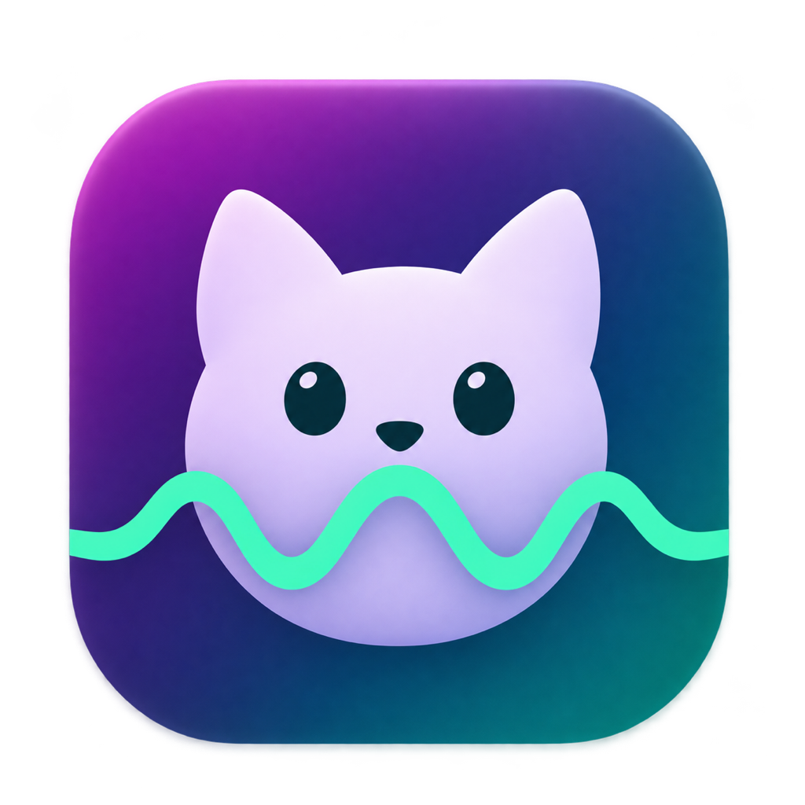

<p align="center">
  
</p>

<h1 align="center">Purrthrough</h1>

<p align="center">
  <strong>Hear your Mac's Line In through your speakers or Bluetooth headphones. A tiny menu-bar cat that just passes the sound through.</strong>
</p>

<p align="center">
  <a href="https://github.com/oana-ffg/purrthrough/releases/latest"></a>
  <a href="LICENSE"></a>
  
  
</p>

## Why

You plug a cable from another computer, a console or a monitor's headphone jack into your Mac's Line In (or a cheap USB sound card), put on your headphones, press play… and hear nothing.

That's because macOS treats every audio input like a microphone. Apps can record from it, but nothing plays it back. Windows has a "Listen to this device" checkbox; macOS doesn't.

The usual workarounds are a paid audio router, a full DAW, or a command line like `ffmpeg` or `sox`. The first two are overkill. The last one is fragile: it stays glued to whichever output was active when you started it and breaks as soon as you connect your Bluetooth headphones. (Some `ffmpeg` builds play one second, garble and go quiet, which is how this app was born.)

Purrthrough is the missing checkbox. It lives in the menu bar as a small meowing cat and plays the input you choose through whatever output your Mac is using right now.

## Features

- **One click.** A meowing cat in the menu bar: bright while it's playing, dimmed when idle, a warning sign when it needs you.
- **Volume up to 400%.** A slider in the menu lifts quiet sources, such as a monitor's headphone jack, with a soft limiter so loud peaks round off instead of crackling.
- **Follows your output.** Switch from speakers to AirPods or other Bluetooth headphones and the sound follows within a moment. It never stays stuck on the speakers behind your back.
- **Lets go of your headphones.** An open output keeps Bluetooth headphones busy even when it only carries silence, so multipoint headphones won't switch to your phone. After 30 seconds without sound from the input, Purrthrough releases the output, and the first sound takes it back a moment later. The very start of that sound is skipped (up to a second on Bluetooth), so a single short blip may not be heard at all. Change the delay or turn it off under **Release Output When Silent**; choose **Never** for a source that is very quiet (below −50 dBFS before the volume boost) or noisy.
- **Bluetooth-friendly.** Purrthrough only opens the input you picked. It never touches your headset's microphone, which would drop the headset into low-quality "call mode". Bluetooth inputs are labelled so you can avoid choosing one by accident.
- **Glitch-free over hours.** Two audio devices never tick at exactly the same speed. Purrthrough keeps a small buffer (40 ms, or a little more for Bluetooth outputs that pull audio in large chunks) and adjusts playback speed by a fraction of a percent, far below what you can hear, so the sound never builds up delay, drops out or clicks.
- **Self-healing.** Unplug the USB sound card and Purrthrough waits for it; plug it back in and playback resumes. Sleep, wake, sample-rate changes and devices that silently stop sending audio all trigger an automatic restart.
- **Picks the obvious input.** On first launch it chooses an input whose name contains "Line". You can pick any other input from the menu.
- **Start at Login** and **signed automatic updates**, each a single toggle in the menu.
- **Lightweight.** Native Swift and Apple's own audio APIs. No kernel extension, no virtual audio driver, no account.

## Install

1. Download `Purrthrough-<version>.dmg` from the [latest release](https://github.com/oana-ffg/purrthrough/releases/latest).
2. Drag **Purrthrough** into **Applications** and open it.
3. When macOS asks whether Purrthrough may use the microphone, click **Allow**. macOS asks this for any audio input, including Line In.

Releases are signed with a Developer ID and notarized by Apple, so the app opens without Gatekeeper warnings.

## Privacy

Purrthrough moves audio straight from the input to the output in memory. It never records, stores or uploads audio and has no analytics. The only network request is the update check against this repository's GitHub releases, which you can switch off with **Update Automatically**.

## How it works

```
input device ──► capture (Core Audio HAL unit)
                     │
                     ▼
            lock-free stereo buffer  ◄── drift controller (10×/second)
                     │                    keeps 40 ms (more for big output
                     ▼                    chunks) queued, nudging speed ±0.5%
      AVAudioEngine: source ► varispeed ► mixer ► current output device
```

- The capture side runs at the input device's native rate; the engine converts to the output's rate (for example 48 kHz USB in, 44.1 kHz Bluetooth out).
- The realtime audio threads never allocate, lock or log. They talk through a single-producer, single-consumer buffer.
- A peak meter on the capture side feeds the silence gate. Sound counts from −50 dBFS, well above a line input's own noise (about −67 dBFS on the author's USB line input). Every 10 seconds the log records the input peak, so you can check where your source's noise sits.
- The buffer target grows to cover the largest chunks the devices actually move. After an underrun it refills before playing again rather than stuttering.
- When the system output changes, only the playback side is rebuilt. The input keeps running and the buffer bridges the gap.

The hardware-independent parts (the buffer, drift control, latency planning, volume, silence detection and input selection) live in `Sources/PurrthroughCore` and are unit-tested with `swift test`, including multi-threaded and bursty-device simulations.

## Build from source

Requirements: Xcode 26 or later and [XcodeGen](https://github.com/yonaskolb/XcodeGen).

```sh
swift test            # core unit tests
xcodegen generate     # creates Purrthrough.xcodeproj from project.yml
open Purrthrough.xcodeproj
```

Signed releases are produced locally by `scripts/release.py`. See [docs/releases.md](docs/releases.md).

## Ideas

- A virtual microphone that mixes Line In with your real microphone, for recording or calls.
- Playing two inputs at once.

MIT licensed. Support: purrthrough@firefungames.com
